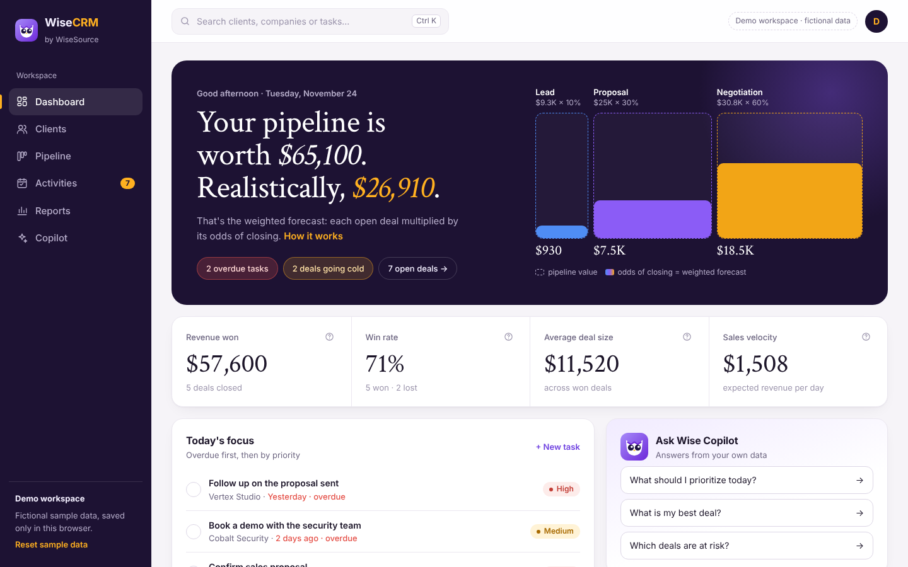
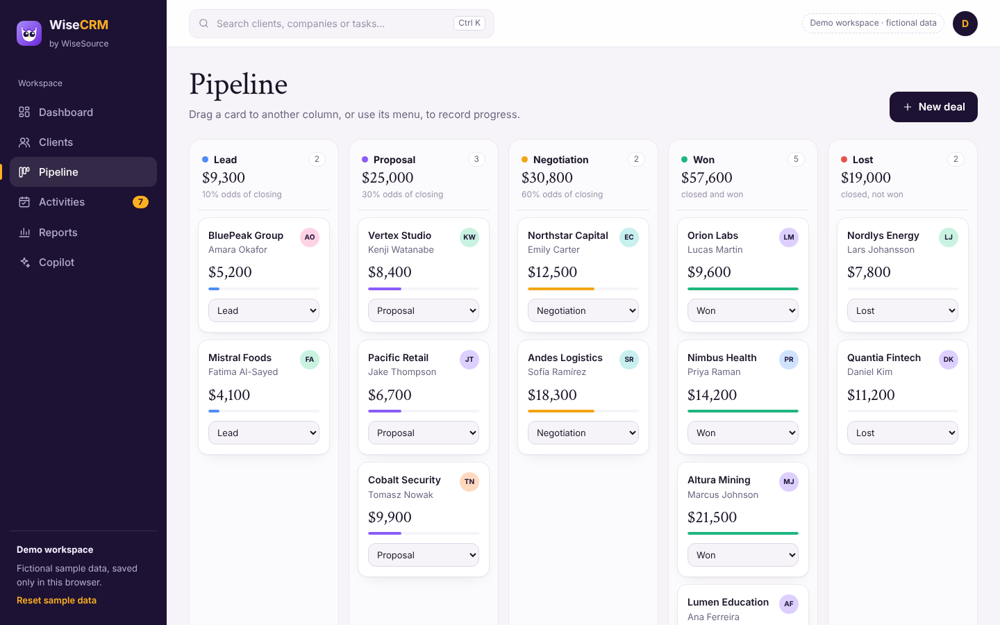
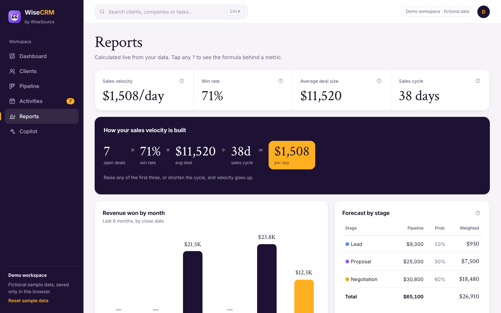

<p align="center">
  
</p>

<h1 align="center">WiseCRM</h1>
<p align="center"><b>The sales CRM that explains its numbers.</b></p>
<p align="center">
  <a href="https://YOUR-PROJECT.vercel.app/?demo">Live demo</a> ·
  <a href="#features">Features</a> ·
  <a href="#architecture">Architecture</a> ·
  <a href="#run-it-locally">Run locally</a>
</p>



WiseCRM is a sales CRM built with **Next.js, React, TypeScript and Supabase**. Beyond the usual contacts and pipeline, it focuses on something most CRMs hide: **the math behind sales metrics**. Every number (weighted forecast, win rate, sales cycle, sales velocity) shows its formula, and an AI copilot answers questions using only your own data.

> Try it without signing up: the live demo opens a sandbox workspace with fictional data stored only in your browser.

## Features

| | |
|---|---|
| **Drag-and-drop pipeline** | Five stages (Lead → Proposal → Negotiation → Won/Lost) with per-stage totals and win probability. Every move can be undone. |
| **Weighted forecast, drawn** | Open deals × stage probability (10% / 30% / 60%), visualized as a mosaic where the filled area is the forecast. |
| **Sales velocity** | `open deals × win rate × average deal ÷ sales cycle`, broken down visually so you can see which lever to pull. |
| **Correct win rate** | Won ÷ (won + lost). Deals still in progress don't drag it down, a common mistake in simple dashboards. |
| **Wise Copilot (AI)** | Ask *"Which deals are at risk?"* or *"What should I prioritize today?"*. Uses Claude via a server route when a key is configured, and falls back to deterministic rules otherwise. |
| **Smart task list** | Overdue first, then by priority. Deals quiet for 7+ days are flagged as "needs attention". |
| **Command palette** | <kbd>Ctrl</kbd>/<kbd>⌘</kbd> + <kbd>K</kbd> to jump to any client, task or section. |
| **Real accounts** | Email/password sign-up with Supabase. Each user gets a private workspace protected by Row Level Security. |
| **Responsive & accessible** | Works on phones, keyboard navigable, visible focus states, reduced-motion support. |

<table>
  <tr>
    <td></td>
    <td></td>
  </tr>
  <tr>
    <td align="center">Pipeline</td>
    <td align="center">Reports</td>
  </tr>
</table>

## Design

WiseCRM is designed like a well-set financial report rather than a generic admin template: white paper, deep plum ink, figures set large in a serif (Instrument Serif) with Geist for text, and one marigold accent taken from the owl's beak. The dashboard's centerpiece is a **forecast mosaic**: each open stage is a column whose width is its pipeline value and whose filled height is its odds of closing, so the filled area *is* the weighted forecast.

## Architecture

```
app/
  page.tsx               → renders <CrmApp/>
  api/copilot/route.ts   → server route: adds the API key and calls Claude
components/
  CrmApp.tsx             → session (demo / Supabase), routing, overlays
  views/                 → Dashboard, Clients, Pipeline, Activities, Reports, Copilot
  overlays/              → client drawer, forms, help, command palette
lib/
  repo.ts                → Repo interface + DemoRepo (localStorage) + SupabaseRepo
  useCrm.ts              → state + optimistic mutations with undo
  metrics.ts             → all business logic: forecast, win rate, velocity…
  copilot.ts             → CRM snapshot for the AI + rule-based fallback
supabase/schema.sql      → tables, indexes, RLS policies, onboarding function
```

**Key decisions**

- **One storage interface, two backends.** The UI only talks to `Repo`. `DemoRepo` keeps a sandbox in `localStorage`; `SupabaseRepo` persists to Postgres. That is how the same screens power both the public demo and real accounts.
- **Optimistic updates.** Changes show instantly; persistence happens in the background, and on failure the app reports the error and reloads from the source of truth.
- **Security by default.** Every table has Row Level Security. Users can only create organizations through a `SECURITY DEFINER` function that makes them the admin, so nobody can add themselves to someone else's workspace. The AI key lives only on the server.
- **Privacy-conscious AI.** The copilot receives a compact snapshot (deals, stages, values, tasks) without emails or phone numbers.
- **Business logic is pure and isolated** in `lib/metrics.ts`, easy to test and reuse.

## Run it locally

Requires Node.js 20+.

```bash
npm install
npm run dev
```

Open http://localhost:3000. With no environment variables, the app runs in demo mode.

### Optional: real accounts (Supabase)

1. Create a free project at [supabase.com](https://supabase.com).
2. In **SQL Editor**, run `supabase/schema.sql`.
3. Copy `.env.example` to `.env.local` and fill in `NEXT_PUBLIC_SUPABASE_URL` and `NEXT_PUBLIC_SUPABASE_ANON_KEY` (Project Settings → API).
4. Restart `npm run dev`. You will see the sign-in screen with a "Try the live demo" button.

### Optional: AI copilot

Add `ANTHROPIC_API_KEY` to `.env.local` (and to Vercel's environment variables). Without it, Copilot uses built-in rules. If the demo is public, set a monthly spend limit on your API key.

## Deploy to Vercel

1. Push this repository to GitHub.
2. In Vercel: **Add New → Project → Import** the repo. Framework is detected automatically.
3. Add the environment variables you use (all optional).
4. Deploy. Share `https://your-project.vercel.app/?demo` to open the sandbox directly.

## Roadmap

- Copilot actions ("create a follow-up task for Andes Logistics on Friday") using tool calling
- Team invitations and role-based permissions (schema already supports `admin / manager / sales`)
- Stage history to measure conversion between each pair of stages
- Unit tests for `lib/metrics.ts` and end-to-end tests for core flows

## Tech stack

Next.js 15 (App Router) · React 19 · TypeScript · Supabase (Postgres, Auth, RLS) · Anthropic Claude API · Vercel · Geist + Instrument Serif

---

Built by **Miguel Ángel Núñez Gallo** · WiseSource. The demo uses fictional data only.
